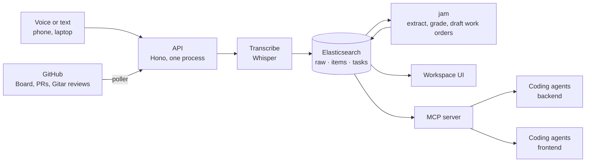

# JAM

**Where a team's context lives when half the team is agents.** Talk, and every coding agent on the team knows within ten seconds. Say a todo out loud, and it comes back as a build prompt assigned to the right person.

Built in one day at the [Cloud Native Hackathon](https://www.wemakedevs.org/hackathons/cnh), Salt Lake City, November 9, 2026, by Cam Hess and Jake Davis. We used it to build itself: the decisions, reviews and task claims from today are in its own database.

- Live: https://jam.cnh.radarhq.io
- Rules both agent teams followed: [`AGENTS.md`](AGENTS.md) · The contract between them: [`packages/shared/src/types.ts`](packages/shared/src/types.ts)

## The problem
Two people, a dozen coding agents, six hours. Within an hour nobody, human or agent, has the same picture of what was decided. Agents build the wrong thing confidently, two of them edit the same file, and the humans become the message bus.

Git versions the code. Nothing versions the conversation that caused the code.

## What JAM does



1. **Capture.** Hold a button and talk, or paste text. The recording is transcribed, cut into chunks, and written to Elasticsearch. Each capture reports how long it took to become searchable; the target is under 10 seconds. Board posts, pull requests and review comments flow in through a poller.
2. **Search.** Hybrid keyword + semantic search over everything the team said and did. "Why does gitops not write to the primary branch" finds the note about Argo CD tracking a deploy branch, with almost no words in common.
3. **Extract and grade.** After each capture, *jam* (an LLM pass) pulls out decisions, todos and questions. Each item links to the transcript chunks it came from and carries jam's own confidence score. A person can confirm or reject any item. The transcript is never edited; jam's layer is allowed to be wrong, and the quote is always attached.
4. **Turn talk into work.** For a confident todo, jam drafts a work order: a build prompt with the team's own words quoted, acceptance criteria, the files it expects to touch, and a suggested owner with the reason. Assignment is plain rules, checked in order: someone was named; else the files all belong to one side; else the speaker's side; else a captain decides. Nothing starts until a person accepts.
5. **Keep agents off each other.** Before editing, an agent claims the paths it will touch. A claim is refused if the path belongs to the other half of the team, or if another agent already holds it; the refusal names the holder, and both sides see the clash.
6. **Give every agent the same brain.** One MCP server exposes all of it: `context_search`, `context_recent`, `context_decisions`, `context_add`, `task_next`, `task_accept`, `task_claim`, `task_done`, `task_list`, `who_owns`, `item_verdict`.
7. **Receipts.** `GET /api/decisions.md` renders the day's decisions, each quoting who said what and when.

There is no custom agent runtime. The harness is one MCP server, one rules file, and a reviewer on every pull request.

## Architecture
One TypeScript monorepo (pnpm).

| Path | What it is |
| --- | --- |
| `apps/api` | Hono HTTP API. Also serves the web app and the MCP endpoint. |
| `apps/worker` | The ingest pipeline (transcribe → chunk → index), jam's extractor and planner, the GitHub poller. Runs inside the API process today. |
| `apps/web` | The workspace UI (Vite + React). |
| `packages/shared` | The contract (`types.ts`), the Elasticsearch store, the delegation and assignment rules. |
| `packages/mcp` | The MCP server. |
| `deploy/`, `argocd/`, `Dockerfile` | One image, one Deployment, Argo CD application. |

Design choices we can defend:
- **Raw first, agent second.** Transcript chunks are the source of truth and are written create-only, so the database itself rejects an edit. Everything an LLM produces is a separate layer that points back at raw chunk ids.
- **Deterministic before generative.** Chunking, ownership, overlap checks and assignment are plain code. The LLM writes summaries and specs, and never decides who may edit what.
- **One contract file.** Frontend and backend were built by two separate agent teams against `packages/shared/src/types.ts`. Contract changes land in their own pull request.
- **One replica, on purpose.** Capture status and the live feed are held in process memory. Splitting the worker into its own Deployment is the next step, and the `Dispatcher` interface is already the seam for it.

## Sponsor tools: what we used and what for

### Elasticsearch — the core data layer
Elastic Cloud Serverless. Three indices: `context_raw` (transcript chunks), `context_items` (what jam extracted), `context_tasks` (claims and work orders). Nothing else stores data.
- Each document has a `text` field for BM25 and a `semantic_text` copy (via `copy_to`) that Elasticsearch embeds on ingest with `jina-embeddings-v5-text-small`. No embedding service of our own.
- Search is one request: an RRF retriever over a keyword query and a semantic query, across raw chunks and items together, filtered by team, person, type, side and time.
- Immutability is enforced by the write (`op_type: create`), not by convention.
- "Searchable in X s" is measured honestly: the write uses `refresh: wait_for`, so the clock stops when the document is visible to search.
- If the inference endpoint is unavailable, search falls back to keyword-only and says so (`mode: "keyword"`).

Code: [`packages/shared/src/elastic.ts`](packages/shared/src/elastic.ts).

### Gitar (Sonar) — a review on every pull request
Gitar reviewed every pull request from the moment it was installed, against our own rules in [`.gitar/review/instructions.md`](.gitar/review/instructions.md). We answered every finding on the PR: fixed, or declined with a reason. Things it caught that would have bitten us:
- **#23** — our agent docs still said to wait for a deploy commit on `main` after we moved it to a `deploy` branch. An agent following them would have waited forever.
- **#30** — a human's confirm/reject could be overwritten if jam's model call was in flight.
- **#39** — two people accepting the same work order at the same moment both succeeded.
- **#25** — after a restart the GitHub poller would re-ingest older items and fill the feed with failures.
- **#26** — the decision log could report an existing source as "not found" past a size cap.

Gitar's reviews are also ingested into JAM, so an agent can search what the reviewer said. It repeatedly flagged pull requests over our own 300-line limit; where we kept them whole we said why on the PR. GitHub's merge queue is not available on a personally-owned repository, so merges were gated on CI and Gitar instead.

### Radar (Skyhook) — where it runs
JAM runs in Radar's hackathon cluster `jam`, namespace `team-jam`, at https://jam.cnh.radarhq.io. One Deployment, one pod: the API, which also serves the workspace and the MCP endpoint. Data lives outside the cluster in Elastic Cloud.
- **GitOps, with `main` kept clean.** Every merge to `main` builds an image tagged with the commit SHA (GitHub Actions → GHCR) and advances a `deploy` branch that Argo CD syncs. The starter template commits the tag straight to `main`; ours goes to a branch that is `main` plus one line, so `main` only ever receives reviewed pull requests.
- **First rollout:** the Secret was created by hand, the Argo CD Application applied once, and the cluster went from the starter page to JAM in under a minute (`/healthz` reports the running commit, which is how a deploy is verified).
- **Manifests** set requests and limits (well inside the team budget), readiness, liveness and startup probes, and run the image as a non-root user.
- **What Radar found, and what we changed.** Once JAM was running we opened Radar's Checks on the cluster. Two findings were ours: the pod had a writable root filesystem, and it mounted a service account token it never uses. We fixed both in one pull request: `readOnlyRootFilesystem: true` with an `emptyDir` for `/tmp`, and `automountServiceAccountToken: false`. We tested the image read-only on a laptop first, merged, and Argo CD rolled it out. One finding we left on purpose: "single replica". Capture status and the live feed are in process memory today, so a second replica would give inconsistent answers until the worker is split out.

### Conferences for everyone (Merge Forward)
Capture is voice-first: no typing, no account, works one-handed on a phone, and the page says out loud when the browser has refused the microphone. Hold-to-talk is also the consent model; nothing records unless someone is holding the button.

## What broke today, and what found it
- **The first real voice note failed.** Chrome's recordings were rejected by the transcription API as undecodable; a synthesized test clip had passed. Found by using it. Fix: re-encode with ffmpeg and retry (#22).
- **Silence became a Korean news sign-off.** A known speech-model hallucination landed in the brain as if someone had said it. Fix: drop segments the model flags as non-speech (#42). The bad chunk is still there, because raw is immutable.
- **jam logged the same decision twice**, the second time from a status post about something else. That is why items now carry a confidence score and a confirm/reject control (#30).
- **The dashboard's p95 read 12.2 s** against a 10 s target, because the GitHub poller's first backfill queued 59 items at once. The number now counts only things a person said (#31).
- **The delegator refused its own orchestrator.** A claim for the next task was rejected because the previous agent's claim on the same files had not been closed. Working as designed.
- **The scaffold sat in a subfolder**, so CI and review rules did nothing until it was moved to the repository root (#1).

## Run it as a desktop app
The native app (`desktop/`, Electron) is a thin shell around the hosted JAM: its own Dock icon and window, the microphone allowed for JAM only, and the terminal bridge started for you when it runs from a clone. The UI updates with every deploy; `Cmd+R` picks it up, no reinstall.
```bash
cd desktop && npm install && npm start            # run it
npm run package && open out/JAM-darwin-arm64/JAM.app   # or build JAM.app (Apple Silicon)
JAM_URL=http://localhost:3000 npm start           # point it at a local server
```
The first launch asks for microphone access; click Allow. `desktop/` has its own npm lockfile and sits outside the pnpm workspace.

No install at all: the Docker launcher runs the whole of JAM locally. Needs Docker. No clone, no Node:
```bash
curl -fsSL https://raw.githubusercontent.com/chito-systems/jam/main/scripts/jam-desktop.sh | bash
```
That pulls the published image, starts JAM on `localhost:8787`, and opens it in its own window. With no credentials it runs in an in-memory demo mode; put `ELASTIC_URL`, `ELASTIC_API_KEY` and `OPENAI_API_KEY` in a `.env` in the folder you run it from to use your own brain. From a clone: `./scripts/jam-desktop.sh` · `--update` pulls the newest build · `--hosted` opens the team's hosted JAM in an app window instead · `--stop` stops it. The web app is also installable from the browser (Chrome: *Install JAM*), which gives the same window and updates itself on every deploy.

## Running it locally
```bash
pnpm install
cp .env.example .env     # ELASTIC_URL, ELASTIC_API_KEY, OPENAI_API_KEY
pnpm dev                 # api on :3000, serving the built web app if present
# no credentials? STORE=memory pnpm dev:api   (keyword search only, nothing persists)
pnpm check               # typecheck, lint, tests: what CI runs
```
Add the brain to a Claude Code session:
```bash
claude mcp add jam --scope user --transport http "http://localhost:3000/mcp?team_id=<team code>&who=<name>&side=backend"
```
Or start a session that is already connected, under its own name, so the workspace can tell agents apart:
```bash
./scripts/jam-agent.sh cam-opus-1 backend     # <human>-<model>-<n>
```
A zero-design capture page is at `/c`; the workspace is at `/`.

## Running it on Kubernetes
`scripts/setup.sh <team>` fills in the namespace. Create the Secret `hack-harness-env` by hand (see [`deploy/RADAR.md`](deploy/RADAR.md)); it is never committed. Apply `argocd/application.yaml` once. After that, merging to `main` deploys.

## What doesn't work yet
- No authentication. A team code scopes the data and that is all.
- Voice and text are sent to OpenAI for transcription and extraction. A local model behind the same `Transcriber` interface is the next step.
- Claims never expire and any teammate can close anyone's task.
- The live feed and capture status are in memory, so the API runs as a single replica.
- OpenTelemetry traces, metrics and logs are implemented and tested against a local collector (#37), but no backend is configured, so they are off.

## What we'd do next
`jam init`: stamp out this repository's setup (rules file, sides, review instructions, CI, contract) for a new team in one command, run by a human captain. Then take the same capture button to the conference itself: a conference is the densest context a developer gets all year, and almost none of it survives the flight home.

## Open-source components
Hono, Zod, `@elastic/elasticsearch`, `@modelcontextprotocol/sdk`, OpenTelemetry JS, Vite, React, Vitest, Biome, tsx (all MIT or Apache-2.0). ffmpeg is installed in the image as a system package (LGPL/GPL, used unmodified as a separate binary). Kubernetes manifests and the deploy workflow started from Radar's `cnh-starter`.

## AI disclosure
Built with AI coding assistants, disclosed per the hackathon rules. Claude Code wrote most of the code: one orchestrator session per side (Claude Fable) designed the architecture and the contract, wrote task briefs, and merged; Claude Opus subagents implemented one brief per pull request. OpenAI models run inside the product (Whisper for transcription, `gpt-5.4-mini` for extraction and work orders). Gitar reviewed every pull request. Cam and Jake chose the product, the tools and the rules, directed every step, and used the product all afternoon. Each pull request states which tools wrote it.

## License
MIT. Copyright 2026 Cam Hess and Jake Davis.
